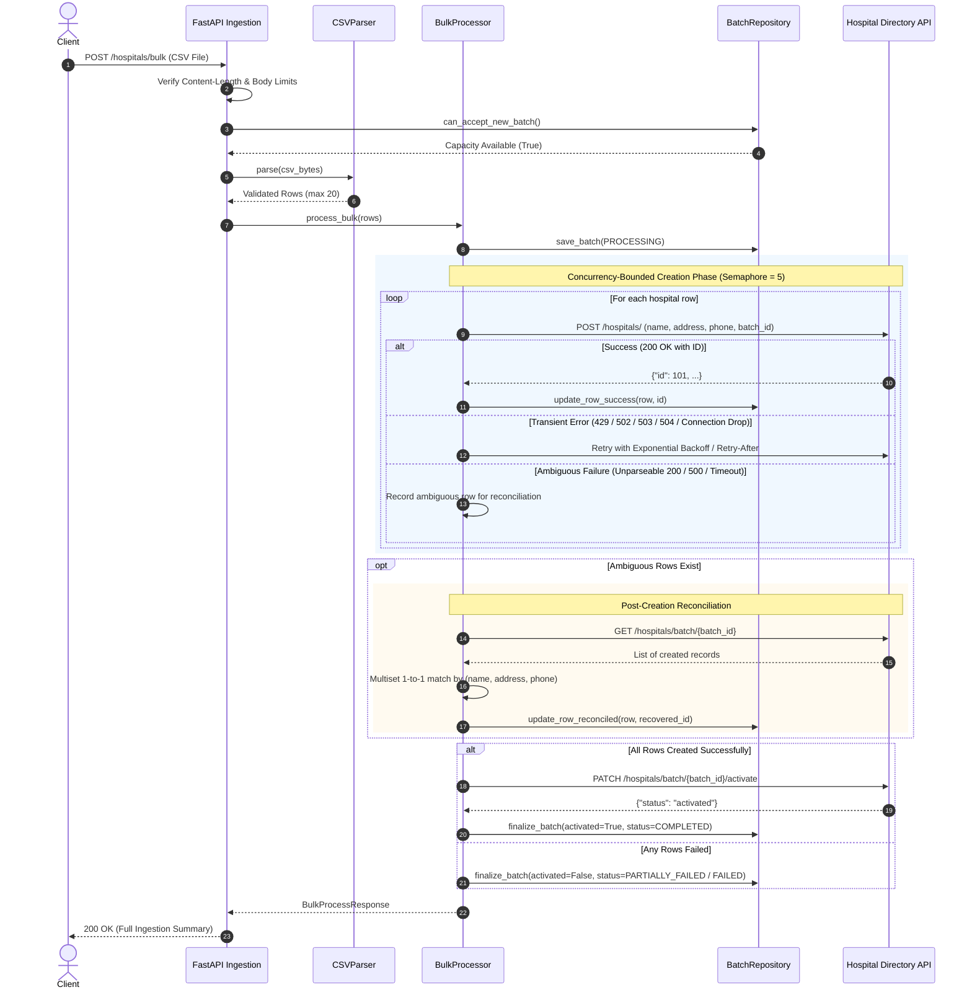

# Hospital Bulk Processing System

Production-grade, asynchronous bulk hospital ingestion microservice integrating with the Hospital Directory API. Built with Python 3.12, FastAPI, `aiohttp[speedups]`, `tenacity`, `loguru`, `pydantic-settings`, and `orjson`.

---

## Architecture & System Design

```
                     ┌──────────────────────────────────────────────┐
                     │            FastAPI Web Ingestion            │
                     │  - Body size streaming limit (413)           │
                     │  - X-Request-ID propagation & context trace  │
                     │  - Opt-in API Key auth & per-IP rate limit   │
                     │  - CORS with safe credential defaults        │
                     └──────────────────────┬───────────────────────┘
                                            │
                                            ▼
                     ┌──────────────────────────────────────────────┐
                     │              CSV Parser Service              │
                     │  - UTF-8 / BOM auto-detection & strip        │
                     │  - Normalized lowercase header mapping       │
                     │  - Duplicate & empty header rejection        │
                     │  - ASCII control character stripping         │
                     │  - Strict 1024-char field length limit       │
                     │  - Enforces max 20 hospital rows             │
                     └──────────────────────┬───────────────────────┘
                                            │
                                            ▼
                     ┌──────────────────────────────────────────────┐
                     │           Bulk Processor Engine              │
                     │  - Shared asyncio.Semaphore concurrency gate │
                     │  - Isolated row processing & error capture   │
                     │  - Ambiguous failure reconciliation          │
                     │  - Multiset 1-to-1 record ID matching        │
                     │  - Atomic two-phase batch activation         │
                     │  - Non-blocking WebSocket broadcasting       │
                     └───────┬──────────────────────────────┬───────┘
                             │                              │
                             ▼                              ▼
              ┌─────────────────────────────┐  ┌─────────────────────────────┐
              │     In-Memory Repository    │  │   Directory HTTP Client     │
              │  - Deep-copy isolated reads │  │  - aiohttp connection pool  │
              │  - Atomic try_mark_processing│  │  - Retry-After backoff wait │
              │  - LRU/TTL batch eviction   │  │  - Safe retry vs ambiguous  │
              │  - Monotonic seq broadcast  │  │  - Idempotent close()       │
              └─────────────────────────────┘  └──────────────┬──────────────┘
                                                              │
                                                              ▼
                                               ┌─────────────────────────────┐
                                               │   Hospital Directory API    │
                                               │ (https://hospital-directory)│
                                               └─────────────────────────────┘
```

---

## Ingestion Lifecycle Sequence Diagram



---

## API Endpoints & Contracts

### 1. Synchronous Bulk Ingestion
- **Method**: `POST`
- **Path**: `/hospitals/bulk`
- **Content-Type**: `multipart/form-data`
- **Body**: `file` (CSV file with headers `name,address,phone`)
- **Status**: `200 OK`
- **Response**:
```json
{
  "batch_id": "550e8400-e29b-41d4-a716-446655440000",
  "total_hospitals": 2,
  "processed_hospitals": 2,
  "failed_hospitals": 0,
  "processing_time_seconds": 0.42,
  "batch_activated": true,
  "hospitals": [
    {
      "row": 2,
      "hospital_id": 101,
      "name": "Mercy General Hospital",
      "status": "created_and_activated",
      "error": null
    },
    {
      "row": 3,
      "hospital_id": 102,
      "name": "St. Jude Children's Hospital",
      "status": "created_and_activated",
      "error": null
    }
  ]
}
```

### 2. Asynchronous Job Ingestion
- **Method**: `POST`
- **Path**: `/hospitals/bulk/jobs`
- **Content-Type**: `multipart/form-data`
- **Body**: `file` (Same CSV structure)
- **Status**: `202 Accepted`
- **Response**:
```json
{
  "batch_id": "550e8400-e29b-41d4-a716-446655440000",
  "status_url": "/hospitals/bulk/550e8400-e29b-41d4-a716-446655440000",
  "ws_url": "/hospitals/bulk/550e8400-e29b-41d4-a716-446655440000/ws"
}
```
*Processing runs as an app-level background task with strong references held until completion or graceful shutdown.*

### 3. Pre-flight CSV Validation
- **Method**: `POST`
- **Path**: `/hospitals/bulk/validate`
- **Status**: `200 OK`
- Checks headers, row count, field lengths, and formats without creating records.

### 4. Get Batch Status
- **Method**: `GET`
- **Path**: `/hospitals/bulk/{batch_id}`
- **Status**: `200 OK` (or `404 Not Found`)
- Returns the deep-copied snapshot of batch metrics and row statuses.

### 5. Resume Incomplete Batch
- **Method**: `POST`
- **Path**: `/hospitals/bulk/{batch_id}/resume`
- **Status**: `200 OK` (or `409 Conflict` if currently processing)
- Runs pre-resume reconciliation against the Directory API to discover records created in previous attempts, retries only pending/failed records, and triggers activation upon complete batch success.

### 6. WebSocket Real-Time Progress Stream
- **Protocol**: `ws://` / `wss://`
- **Path**: `/hospitals/bulk/{batch_id}/ws`
- Features: Monotonically increasing sequence IDs (`seq`), capacity limiting per batch and globally (closes with code `1013` on capacity exhaustion), `4404` for unknown batches, and graceful close code `1000` on finalization.

#### WebSocket Event Schema
```json
{
  "event": "initial_state | row_completed | row_failed | batch_finalized | error",
  "seq": 0,
  "batch_id": "550e8400-e29b-41d4-a716-446655440000",
  "total_hospitals": 2,
  "processed_hospitals": 1,
  "failed_hospitals": 0,
  "status": "processing",
  "batch_activated": false,
  "row_result": {
    "row": 2,
    "hospital_id": 101,
    "name": "Mercy General Hospital",
    "status": "created",
    "error": null
  }
}
```

### 7. Split Health Check Probes
- **Liveness**: `GET /health` -> `200 {"status": "ok"}` (purely local, instant, used by container orchestration).
- **Readiness**: `GET /ready` -> Checks downstream Directory API with short timeout; returns `200` if reachable or `503` if degraded/unreachable.

---

## Batch & Row Status Matrix

| Batch Status | Meaning | Conditions |
| :--- | :--- | :--- |
| `initialized` | Batch created and stored in repository | Initial state prior to worker execution |
| `processing` | Ingestion or resume workers actively executing | Downstream calls in progress |
| `completed` | All records successfully created and batch activated | `failed == 0` and `batch_activated == True` |
| `activation_failed` | All records created remotely, but activation call failed | `failed == 0` and `batch_activated == False` |
| `partially_failed` | Some records created, but one or more rows failed | `failed > 0` and `processed > 0` |
| `failed` | No records could be created remotely | `processed == 0` and `failed > 0` |
| `interrupted` | Ingestion was cancelled (SIGTERM, shutdown, client abort) | Caught `asyncio.CancelledError` |

| Row Status | Meaning |
| :--- | :--- |
| `pending` | Row parsed and queued for creation |
| `processing` | Downstream HTTP call currently in flight |
| `created` | Created downstream under `creation_batch_id`, not yet activated |
| `created_and_activated` | Created downstream and batch activation completed |
| `failed` | Row creation permanently failed (after retries and reconciliation) |

---

## Retry, Ambiguity & Reconciliation Policy

Downstream operations strictly categorize network and HTTP outcomes to avoid duplicates:

1. **Safe to Retry (Tenacity Exponential Backoff with Jitter):**
   - Connection setup failures (`ClientConnectorError`, `ConnectionTimeoutError`).
   - Remote rate limits (`429 Too Many Requests`), honoring downstream `Retry-After` header capped at `MAX_RETRY_AFTER_SECONDS`.
   - Transient gateway errors (`502 Bad Gateway`, `503 Service Unavailable`, `504 Gateway Timeout`).

2. **Ambiguous Outcomes (Do NOT Retry Directly):**
   - HTTP 200 with non-JSON or malformed payload.
   - HTTP 500 Internal Server Error (server may have committed before crashing).
   - Read / total timeouts after request was transmitted.
   - Mid-response server disconnects.
   *Resolution*: Mark row ambiguous, query `GET /hospitals/batch/{batch_id}`, and match via multiset on normalized `(name, address, phone)` to recover the remote ID.

3. **Client Errors (Never Retried):**
   - `400 Bad Request`, `422 Unprocessable Content` (invalid data).

---

## Configuration Settings

Configured via environment variables or `.env`:

| Setting | Type | Default | Description |
| :--- | :--- | :--- | :--- |
| `DIRECTORY_API_BASE_URL` | `HttpUrl` | `https://hospital-directory.onrender.com` | Target Directory API root URL |
| `MAX_CSV_ROWS` | `int` | `20` | Maximum rows allowed per CSV upload |
| `MAX_CONCURRENT_REQUESTS`| `int` | `5` | Concurrency limit for downstream API calls |
| `REQUEST_TIMEOUT_SECONDS` | `float` | `15.0` | Per-request downstream HTTP timeout |
| `MAX_ATTEMPTS` | `int` | `3` | Maximum downstream attempts (`max_retries` alias supported) |
| `MAX_FILE_SIZE_BYTES` | `int` | `2097152` | Maximum upload size in bytes (2 MB) |
| `MAX_STORED_BATCHES` | `int` | `1000` | In-memory batch storage limit |
| `BATCH_TTL_SECONDS` | `float` | `86400.0` | Time-to-live for finalized batches (24h) |
| `STALE_BATCH_TIMEOUT_SECONDS` | `float` | `300.0` | Time after which an inactive `processing` batch may be resumed |
| `MAX_RETRY_AFTER_SECONDS` | `float` | `30.0` | Maximum wait duration honored from `Retry-After` |
| `CONNECTION_POOL_LIMIT` | `int` | `100` | Global TCP connection limit |
| `CONNECTION_POOL_LIMIT_PER_HOST`| `int` | `25` | Per-host connection limit |
| `MAX_WEBSOCKET_SUBSCRIBERS_PER_BATCH` | `int` | `10` | Concurrent WS subscribers per batch |
| `MAX_WEBSOCKET_TOTAL_SUBSCRIBERS` | `int` | `100` | Global concurrent WS subscriber cap |
| `CORS_ALLOWED_ORIGINS` | `list[str]` | `[]` | Allowed origins (credentials disabled on wildcard) |
| `API_KEY` | `str \| None` | `None` | Optional service API key (validated via `X-API-Key`) |
| `RATE_LIMIT_ENABLED` | `bool` | `False` | Enable in-memory per-IP sliding rate limiting |
| `RATE_LIMIT_REQUESTS_PER_MINUTE` | `int` | `60` | Request threshold per IP per minute |
| `LOG_LEVEL` | `Literal` | `INFO` | Logging level (`DEBUG`, `INFO`, `WARNING`, `ERROR`, `CRITICAL`) |
| `LOG_JSON` | `bool` | `False` | Structured JSON log output for Render / Datadog |

---

## Limitations & Trade-offs

1. **In-Memory State**:
   - The repository uses an async-safe, single-process in-memory dictionary. State is lost on process restart.
   - Suitable for single-instance container deployments (e.g. Render Web Service).
   - **Production Scale-Out Path**: Swap `BatchRepository` with Redis or PostgreSQL persistence and use Redis Pub/Sub for cross-worker WebSocket broadcast.

2. **Render Free Tier Cold Starts**:
   - On the Render free tier, web services spin down after 15 minutes of inactivity. The first request after sleep may take 30–50s to spin up.
   - A 20s graceful shutdown timeout is configured on Uvicorn (`--timeout-graceful-shutdown 20`) to allow running batches to finalize cleanly on SIGTERM.

3. **Downstream API Latency**:
   - Synchronous `POST /hospitals/bulk` holds the client connection open while downstream records are created. For larger payloads or slow networks, clients should use `POST /hospitals/bulk/jobs` with WebSocket progress tracking.

---

## Development & Testing Workflow

### 1. Setup
```bash
# Install dependencies with uv and register pre-commit hooks
task install
```

### 2. Available Task Commands
```bash
task check            # Run all static quality gates (lint, typecheck, test, pre-commit)
task test             # Run pytest suite
task cov              # Run pytest with terminal coverage report enforcing 90% threshold
task ci               # Run complete local CI pipeline
task typecheck        # Run strict mypy check
task lint             # Run ruff linter
task format           # Format codebase with ruff
task dev              # Start local dev server with auto-reload
task samples          # Regenerate sample CSV test files
task build            # Build multi-stage production Docker image
task up               # Run Docker Compose stack
task down             # Stop Docker Compose stack
```

### 3. Docker Deployment & Local Verification
```bash
docker build -t hospital-bulk-processor .
docker run -p 8000:8000 -e PORT=8000 hospital-bulk-processor
```
Liveness probe verification:
```bash
curl http://localhost:8000/health
# {"status":"ok"}
```
